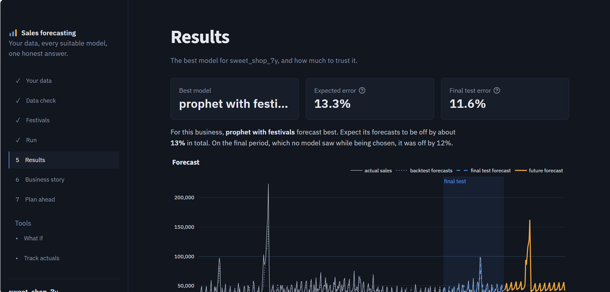

# Personalised Sales Forecasting

**Upload one business's sales history. Every model that suits that much data competes on it, the
winner is chosen by a year-long backtest, and the business gets an honest accuracy estimate, a
story about its own data, and plans for stock, staff and cash.**

Built for small businesses, with India in mind (festival calendars, official inflation data,
amounts in lakh and crore), but it works with any daily, weekly or monthly sales file.

**[Open the live app](https://aipoweredbusinessforecastingsuite-cnzlndd6tzyvdsjlt3er93.streamlit.app/)** (free hosting: if it has been idle, click the button to wake it and give it about a minute).



---

## What it does

| Step | What happens |
|---|---|
| **1. Your data** | Upload a CSV (any date column + any sales column) or try the simulated demo shop. A live preview checks the columns before anything runs. |
| **2. Data check** | Detects daily / weekly / monthly data, adds up duplicate dates, fills and flags missing dates, and assigns a **size tier** that decides which models may compete. |
| **3. Festivals** | Measures how much **each holiday** moves *this* business's sales, groups holidays that fall within days of each other, and lets the user tick the ones the models should use. Custom dates (a local fair, a yearly sale) can be uploaded. |
| **4. Run** | Backtests every allowed model over about a year and picks the winner. |
| **5. Results** | The winner, its expected error, a final test on data no model saw, the full leaderboard and the forecast. |
| **6. Business story** | Growth, **real growth after inflation** (official Indian CPI), closures and recovery, weekday and monthly patterns, and what each festival is worth in money. |
| **7. Plan ahead** | Busy/normal/quiet weeks, units to prepare, month-by-month cash, and rules of thumb tied to the numbers. |
| **Tools** | **What if** (price changes, a new outlet, quiet-week offers) and **Track actuals** (real sales vs the forecast range, with early warnings). |

## How the model is chosen

**More data unlocks more complex models** (rules of thumb, documented in `forecaster/data_check.py`):

| Tier | History | Models allowed |
|---|---|---|
| Too small | under 1 year | none: no forecast |
| Small | 1-2 years | simple baselines, exponential smoothing, ARIMA |
| Medium | 2+ years | + Prophet, gradient boosting, random forest, linear regression |
| Large | 2+ years **and** 1,000+ data points | + LSTM (PyTorch), optional because it is slow |

**Backtesting, not a single test window.** Every model forecasts several 90-day windows that
together cover about a year, each trained only on data before it. The winner is the lowest
error across all windows; it is then scored once on a final period that played no part in choosing
it. Failed models are shown as failed, never given a made-up score.

## Results on the simulated sweet shop (7 years of daily sales)

| Model | Family | Error (WAPE) |
|---|---|---|
| **Prophet with festivals** | Prophet | **13.3%** |
| Gradient boosting | machine learning | 15.1% |
| Random forest | machine learning | 15.6% |
| Linear regression | machine learning | 16.9% |
| LSTM | deep learning | 17.0% |
| Exponential smoothing | statistical | 18.7% |
| ARIMA | statistical | 20.6% |
| Best simple baseline | baseline | 23.3% |
| *Best possible (noise built into the simulation)* | | *about 10.5%* |

Because the data is simulated, the true pattern is known, so we can say how close the winner gets
to perfect: within about 3 points.

## What I learned building it

- **A hidden default nearly sank Prophet.** Prophet silently switches off its yearly pattern with
  under 2 years of data: error went from 51% to 24% just by switching it back on.
- **One validation window can lie.** The first version judged models on July-September, then used
  the winner to forecast Diwali. Backtesting over a full year exposed it: the "best" baseline dropped
  to last place.
- **Festivals next to each other cannot be told apart from sales alone.** Bhai Duj "earned" +139% by
  sitting two days after Diwali. The app groups such holidays and lets the owner choose.
- **The LSTM went from 47% (worse than every baseline) to 17%** without changing much in the network:
  festival inputs, more data and a fair backtest made the difference.
- **Totals hide problems.** In Track actuals, a 40% drop from mid-November barely moved the 12-week
  total (+0.6%), but the weekly view flagged six weeks in a row below range.

## Data

- **Demo data is simulated** (`synthetic_data.py`): a sweet shop with growth, weekly and yearly
  patterns, Diwali / Raksha Bandhan / Holi, a 2020 lockdown, closures and noise. It is not real
  company data, and the app labels it as simulated everywhere.
- **Holidays:** the open-source [`holidays`](https://github.com/vacanza/holidays) library (public
  and optional lists). Community-maintained, not an official government list.
- **Inflation:** official all-India CPI (Combined, General Index) from MoSPI's eSankhyiki portal,
  base 2012, Jan 2013 to Dec 2025, continued into 2026 with the new series' (base 2024) published
  year-on-year rates. See `build_cpi.py`. The default without that file is 4%, the RBI's target.

## Honest limitations

- Tier thresholds are rules of thumb, not universal laws.
- Personalised (one model per business) does not automatically mean more accurate: a small business
  has few examples to learn from. The tool's promise is that it tests what works on *your* data and
  says how accurate it is.
- Suggestions are simple rules based on the numbers, not expert business advice.
- What-if results are only as good as the user's assumptions.
- The 2026 CPI figures are first-release values; MoSPI may revise a month by about 0.1 point.

## Run it locally

Tested with Python 3.14 on Windows.

```
python -m venv venv
venv\Scripts\activate            # on macOS/Linux: source venv/bin/activate
pip install -r requirements.txt
streamlit run app.py
```

Command-line versions of the pipeline: `run_forecast.py`, `holiday_report.py`, `check_my_data.py`.

## Project structure

```
app.py                      the Streamlit app (7 steps + 2 tools)
forecaster/
  data_check.py             load any file, detect frequency, size tiers
  competition.py            backtesting, model selection, final test
  calendar.py               holidays, festival impact, groups
  insights.py               business story, plans, what-if, tracking
  inflation.py              real vs money growth
  charts.py                 Plotly charts
  models/                   baselines, statistical, Prophet, machine learning, LSTM
synthetic_data.py           the simulated demo businesses
build_cpi.py                builds data_external/cpi_india.csv from the MoSPI download
```

## How this project evolved

This started as my B.Tech capstone (an earlier Streamlit forecasting app, still visible in the
commit history). The rebuild replaced fixed models and a single test split with automatic,
data-size-aware model selection, honest backtesting, festival-aware forecasting and business
insights, on Python 3.14 with PyTorch.
